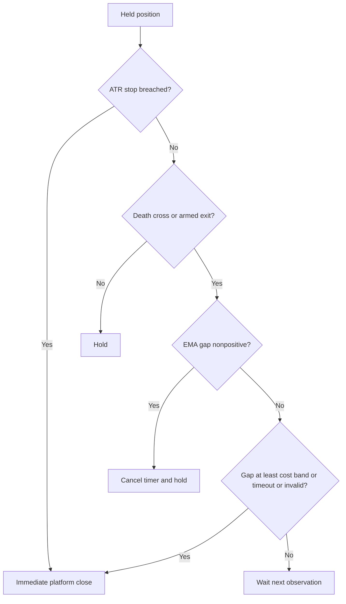

# V1.4-S3 — Cost-aware trend exit
Independent ablation against V1.4-A. S1 and S2 are not included. S2 run 44877488082 completed successfully; performance not yet audited in this experiment.
## Hypothesis
Small bearish EMA gaps following a death cross may reverse before a sell-and-reenter cycle is economically worthwhile. Use an estimated friction band as a hysteresis proxy, not an expected return forecast. Entry fees already paid are sunk costs.
## Mechanism
At each valid hourly observation, calculate prior-observation EMA gap D = EMA50 - EMA20. On death cross arm an exit timer. Estimate exit-and-reentry friction per BTC C = 2P(0.0005+0.0001+0.02*entryATR/P). Use frozen entry ATR to avoid extra historical queries; it is not a current volatility estimate. If D >= C, close immediately; if D <= 0, cancel the pending trend exit; if 0 < D < C, wait until the next observation, but exit if still bearish at or after six elapsed hours. Invalid gap/band triggers exit. Six hours is a preselected development hypothesis, not optimized. Gaps in observed data can delay execution beyond timer duration. ATR stop is checked first at every eligible observation, bypassing cost delay. Pending orders and halt behavior remain unchanged. The exit timer resets on opening confirmation or final close. Log COST_EXIT_CHECK with time, gap, band, timer and decision. 

## Experiment
BTCUSD, hourly, 2021–2024, USD 10,000, 1x, risk 0.5%, max allocation 50%. All entry conditions, sizing, stop anchoring and native market order execution unchanged. Omit TradeCost entirely. Estimated friction only affects decisions, native metrics are not cost-adjusted. 2025 excluded. Compare with A on score, PnL, Sharpe, drawdown, trade count, holding duration, exit reasons, cancelled/timeout exits, tail losses and missed opportunities. Confirm each eligible ATR breach bypasses waiting. No claim that lower turnover necessarily improves net returns. 
