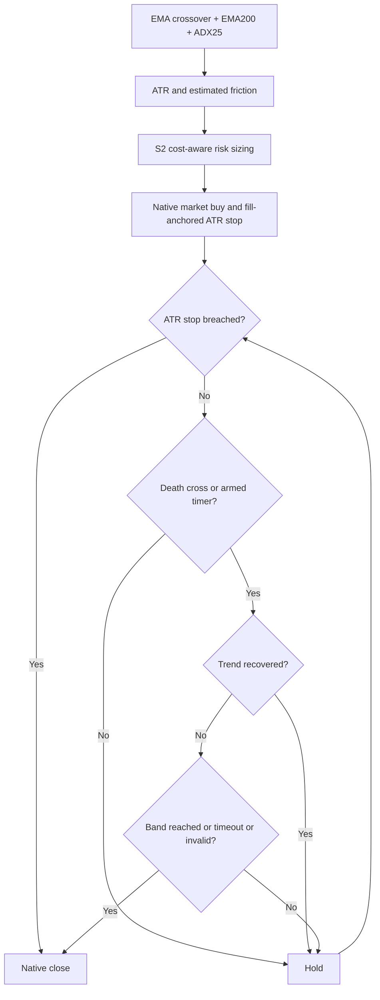

# V1.4-S4 — Combined cost-aware sizing and exit
## Hypothesis and controls
Combine the unchanged S2 sizing mechanism with the unchanged S3 exit hysteresis. Exclude S1's minimum relative ATR entry gate; prior analysis found it missed important trend winners. Primary comparison S4 vs S2 isolates incremental exit effect under cost-aware sizing; secondary comparisons A and S3 assess interaction. No parameter retuning. Prior results are documented in [cost-aware ablation results](BTC-V1.4-S_cost_aware_results.md).
## Mechanism
Same V1.4-A EMA20/50 crossover, prior price above EMA200, ADX14 > 25, ATR14 calculation from completed historical observations. S2 estimated per-BTC round-trip friction C=2P(0.0005+0.0001+0.02*ATR/P). Size contracts using the minimum of 0.5 NAV/95% available cash cap and 0.005 NAV/((3 ATR+C)*contractSize), floored to four decimals; allocation cap also includes P*contractSize as denominator. Confirm native fill, set fixed 3 ATR stop. S3 checks ATR stop first at each eligible observation; death cross arms timer, compare previous EMA50−EMA20 to cost band using entry ATR and current quote. Exit if gap >= band, invalid data, or still bearish after 6 elapsed hours; cancel timer on recovery. Time cap evaluated on observed quotes, not guaranteed wall-clock execution. Pending order and halt handling unchanged. No cost entry filter. Fees/slippage are hypothetical decision inputs only, not actual costs or changed fills.

## Fixed settings and evidence
BTCUSD, 60min, January 2021–December 2024, USD 10000, 1x, long/flat, 0.5% risk budget, 50% NAV allocation cap, 95% cash cap, no TradeCost field, 2025 excluded. Independent native cloud run; offline regression tests before submission. Preserve RISK_SIZE, COST_RISK_SIZE, COST_EXIT_CHECK, ATR_STOP_SET, EXIT_SIGNAL, stats, trades and daily PnL. Native metrics gross of assumed extra friction. Evaluate Score, PnL, Sharpe, Sortino, drawdown magnitude/duration, full matched trades, holding time, exit reasons, risk budget compliance, yearly PnL. If S4 fails to improve materially, retain simpler A/S2 rather than force combination. No claim of net cost savings.

## Verified results and decision (2026-11-21)
Native run [44884286425](../../actions/runs/44884286425), artifact 14699591114, evidence.json COLLECTED. Reopened A/S2/S3/S4 original artifacts 14695151074/14697096797/14698953143/14699591114. Effective TradeCost 0.0 in all four. 
| Metric | A | S2 | S3 | S4 |
|---|---:|---:|---:|---:|
| Score |57.347774|57.354357|56.543643|56.579998|
| PnL USD |3059.17|2789.78|3139.59|2866.30|
| Sharpe |1.165426|1.159930|1.118056|1.115375|
| Max DD % |3.4350|3.1942|3.9653|3.6404|
| Activeness score_TradePerDay |3.749004|3.749004|4.264622|4.264622|
| Trade records |127|127|125|125|
| Avg DD days |86.85|86.85|95.69|95.72|
| 2021 PnL |849.91|809.27|940.52|897.89|
| 2022 PnL |249.38|228.97|183.40|167.13|
| 2023 PnL |1278.46|1143.11|1246.43|1113.37|
| 2024 PnL |681.42|608.43|769.24|687.91|
S4 logs: 63 opens/62 closes, 40 band exits, 9 timeout exits, 13 ATR exits; 204 WAIT, 9 RECOVERED. 63 COST_RISK_SIZE observations, mean planned combined risk 0.497669%, max 0.499990%. S3 has identical counts; S4 does not improve the exit mechanism. Relative to S2: +76.51 USD PnL, -0.774359 score, higher DD and lower Sharpe. Activeness score increases despite fewer records, so do not infer its formula from transaction count alone. S2 selected as V1.5-A development control, based on highest score and explicit risk budget rather than meaningful score superiority to A (difference 0.006583). No S1 or S3 gate in V1.5. V1.5-B/C/D remain planned, not submitted; no 2025 use.
