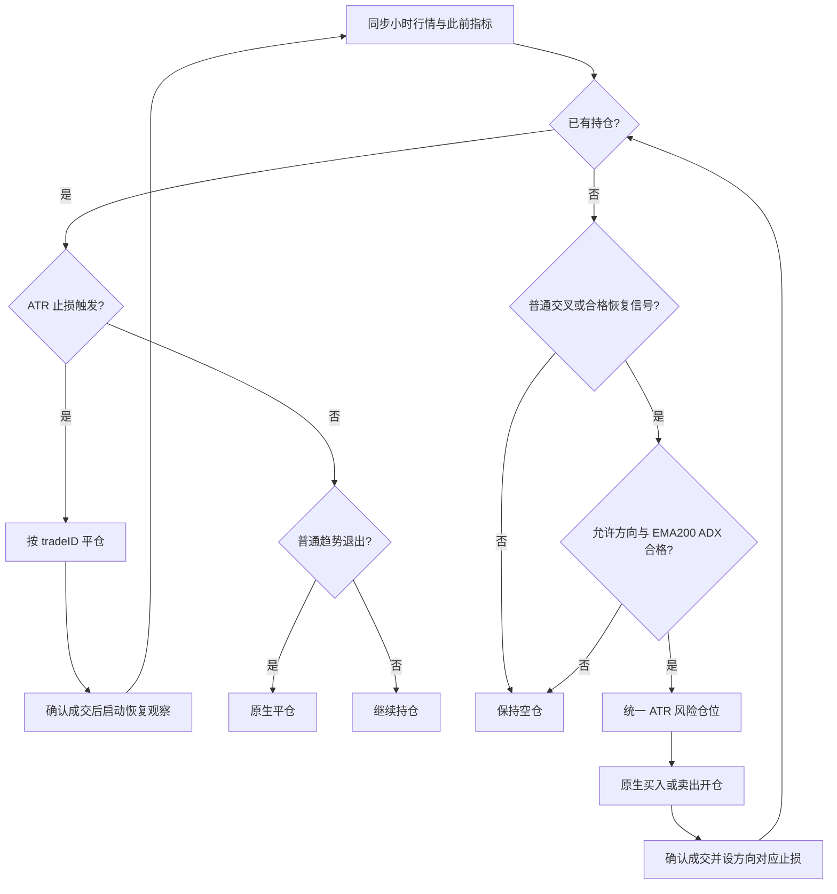

# V1.5 — 交易活跃度、多空双向与止损后重新入场
研究计划（尚未实现或提交回测），2026-11-21。先结束 V1.4-S4 评估并冻结统一基准，再开展本阶段；LLM 顺延至 V1.6。

## 1. 问题与研究目标
历史 V1.4-A 四年 127 条交易记录、64 次开仓、63 次完整平仓，约每月 1.31 组完整交易。EMA 金叉一次性触发、ADX25 与 EMA200 过滤、仅做多、止损后必须等待新的金叉，是活跃度不足的主要逻辑原因。平台 Activeness 精确评分公式尚未核实。目标是提高有质量的交易机会、原生 Score 与风险调整收益，不为刷交易频率而交易。其他候选：缩短 EMA、趋势内回调买入、多资产、较短周期；本阶段暂不改变这些因素。

## 2. 多空双向机制
| 条件 | Long | Short |
|---|---|---|
| 普通入场 | EMA20 上穿 EMA50 | EMA20 下穿 EMA50 |
| 长期方向 | 先前价格 > EMA200 | 先前价格 < EMA200 |
| 趋势强度 | ADX14 > 25 | ADX14 > 25 |
| 止损锚点 | 确认成交价 − 3ATR | 确认成交价 + 3ATR |
| 止损触发 | 当前观测价格 <= 止损价 | 当前观测价格 >= 止损价 |
| 普通退出 | EMA 死叉 | EMA 金叉 |
| 风险预算 | 0.5% NAV | 0.5% NAV |
| 总名义仓位上限 | 50% NAV | 50% NAV |

成本感知仓位采用选定基准的公式，若采用 S2 则将每 BTC 预估往返摩擦 C 纳入风险分母：q=floor(min(min(0.5 NAV,0.95 available)/(P*m),0.005 NAV/((3 ATR+C)*m))*10000)/10000。若基准最终采用其他机制，四组必须统一。若选择 S4 作为基准，空头普通退出的成本回滞机制需要对称实现，ATR 强制止损仍优先。初轮多空参数对称，不增加杠杆、不允许同时多空持仓、不自动同小时反手；平仓确认后才可重新考虑开仓，记录因持仓而跳过的反向信号。平台配置对双向版本启用 allowShortSell，代码明确发送卖出开仓（buysell=-1）并验证成交方向、合约规格与保证金；只开启设置不等于实现做空。多空方向以实际成交日志为准。实盘须另外考虑融券、资金费率、保证金与逼空风险。

## 3. 止损后重新入场
只对已确认完成的 ATR 止损平仓启动恢复观察，不因普通 EMA 退出或未确认订单启动；冷却至少12个经过小时。初始参数为待验证假设。
| 条件 | Long | Short |
|---|---|---|
| 冷却期 | >=12小时 | >=12小时 |
| 短期趋势 | EMA20 > EMA50 | EMA20 < EMA50 |
| 长期趋势 | 先前价格 > EMA200 | 先前价格 < EMA200 |
| ADX | >25 | >25 |
| 恢复确认 | 价格重新上穿 EMA20 | 价格重新下穿 EMA20 |
| 同一趋势重新入场上限 | 2次 | 2次 |
| 仓位与止损 | 与基准一致 | 对称实现 |

实现约定（待代码验证）：趋势周期以 EMA20/50 方向变化划分，反向交叉清除旧恢复资格及计数；恢复信号使用决策前已完成观测，冷却期内信号不排队、不提前成交；冷却结束后需要新的恢复交叉；仅确认重新开仓成交后计数增加。新开仓重新计算 ATR 和仓位，按真实成交锚定止损，不复用旧止损。在无效指标、未确认订单、系统停止或有持仓时禁止新的交易。每次记录趋势周期、止损时间、冷却、恢复交叉、ADX、EMA200、次数和拒绝原因。测试连续止损、冷却边界、方向切换、次数限制、数据缺失和订单拒绝。不得为增加活跃度跳过强制止损。

## 4. 交易流程

## 5. 2×2 因子实验
| 版本 | 做多 | 做空 | 止损后重新入场 | 研究目的 |
|---|---|---|---|---|
| V1.5-A | 是 | 否 | 否 | 冻结的 V1.4 基准 |
| V1.5-B | 是 | 是 | 否 | 增加做空的独立作用 |
| V1.5-C | 是 | 否 | 是 | 恢复入场的独立作用 |
| V1.5-D | 是 | 是 | 是 | 联合作用及交互 |
顺序 A（复用已验证同配置结果或必要时重跑）、B、C、D。对任一指标 Y，做空独立效应=B−A，重新入场独立效应=C−A，联合增量=D−A，交互项=D−B−C+A。该差分是描述性开发样本比较，不代表统计因果显著性。Short-only、非对称风险预算作为后续可选诊断，不改变本轮编号。

## 6. 固定配置及评价
BTCUSD、60min、2021-01 至 2024-12、USD 10000、1x、目标仓位上限50%、风险预算0.5%、TradeCost 完全省略；手续费滑点仅决策输入，原生结果不扣估计成本。2025 保留检验，不用于参数选择。独立 GitHub Actions、串行原生云回测、原始 evidence.json、有效设置、订单及日度 PnL、决策日志；先测试再提交。
重点评价 Activeness 原生分项、完整交易年均/月均次数、Score、PnL、Sharpe、最大回撤及持续时间、年度收益、持仓时间占比、连续止损次数、按方向与入场类型分类的完整交易数量/盈亏/胜率/PF。多空各自 Sharpe 仅在能够重建含持仓浮盈的分方向每日收益序列时计算，否则标不可用；重新入场贡献为平台口径未扣额外假设成本的实际分类盈亏，不能称真实成本后净收益。检查新增交易是否只是替代原有机会。保留所有失败结果，不以活跃度单项替代整体风险收益。

## 7. 后续路线
V1.4-S4 完成并复核 → V1.5-A/B/C/D → 选择统一可复现基准 → V1.6 LLM（状态识别、多空/空仓或恢复许可、受限风险档位；传统规则对照、因果输入、训练历史记忆泄露风险及失败回退） → V2.0 冻结与2025检验。此前项目曾使用2025，不能宣称全局严格未见。

## 8. 基准选定
S4 原始结果已核实（Score 56.579998），选择 V1.4-S2 为 V1.5-A：Score 57.354357，PnL 2789.782737，Sharpe 1.159930，最大回撤 3.1942%，score_TradePerDay 3.749004，127 记录、63 完整交易，9 ATR 退出。采用 S2 成本感知风险预算，普通 EMA 反向交叉立即退出，不继承 S3 延迟退出或 S1 成本入场过滤。B/C/D 尚未提交。提高活跃度同时须检查风险收益；S4 活跃度分项 4.264622 却只有125条记录，精确评分算法仍未核实。
