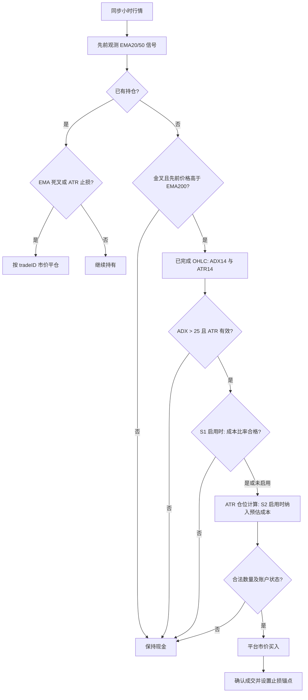

# BTC 单资产趋势策略：完整机制与实验安排
> 研究设计汇总，2026-11-21。用于复现实验与课程报告，不是最终绩效报告。已完成、待验证与计划中的机制分别标记。所有正式回测均在 ALGOGENE 原生 Backtest 执行。

## 1. 研究目标与统一约束
研究 BTCUSD 小时级趋势跟随策略，以平台 Score 为主要开发目标，同时审查收益、风险调整收益、资金使用与稳健性。采用逐步机制消融，而不是一次性叠加全部规则。当前成本研究目标是让预估手续费和滑点参与交易决策，不要求实际平台扣费；完全省略 TradeCost，不修改平台成交价格，不使用外部引擎替代平台成绩。

| 设置 | 值 |
|---|---|
| 标的 | BTCUSD |
| 数据间隔 | 60min |
| 开发期 | 2021-01 至 2024-12 |
| 保留检验 | 2025；本研究阶段未使用，历史项目曾接触该年，不能称全局严格未见 |
| 初始资金 | USD 10,000 |
| 杠杆 | 1x |
| 实际方向 | Long/Flat；仅买入开仓、平仓 |
| 仓位限制 | 50% NAV 和 95% 可用资金 |
| 无风险利率 | 0 |
| 新闻/天气/经济数据 | 不启用 |
| TradeCost | 字段完全省略 |

2021–2024 已用于选择参数，年度分解和滚动诊断仍是开发期分析。冻结策略及假设后方可进行 2025 最终检验。

## 2. 策略演进与研究假设
| 版本 | 相对基准的机制 | 假设及用途 |
|---|---|---|
| V1.0 | EMA20/50 金叉入场、死叉退出 | 趋势延续产生收益，建立基础对照 |
| V1.1-A/B/C | ADX14 > 20/25/30 | 过滤弱趋势；B 为后续开发基准 |
| V1.2-B | 3×ATR14 固定止损 | 限制快速反转损失 |
| V1.3-A | 小时 EMA200 趋势方向过滤 | 降低逆长期趋势的错误开仓 |
| V1.3-D | EMA200 斜率恢复条件 | 研究趋势恢复；此前分析显示未产生增量，保留 A |
| V1.4-A/B/C | 0.5% / 1% / 1.5% NAV ATR 风险预算 | 波动率自适应仓位、风险收益权衡 |
| V1.4-S1 | 单独加入成本感知入场过滤 | 避免摩擦相对波动空间过大的交易 |
| V1.4-S2 | 单独加入成本感知仓位 | 将预计摩擦纳入计划风险预算 |
| V1.4-S3 | 待设计：成本感知普通趋势退出 | 减少轻微反转引起的反复开平仓，同时不延迟强制止损 |
| V1.4-S4 | 待设计：选定机制组合 | 检查交互作用与整体改善 |
| V1.5 | 待设计：LLM 市场状态识别/风险预算 | 检验相对于传统量化规则的增量价值 |
| V2.0 | 冻结后 2025 检验 | 检验泛化，不根据检验结果反向调参 |

可选未实施对照：2 ATR 固定止损、3 ATR 移动止损、日线 EMA50/200、更细风险预算。不是必做项目；避免无假设的枚举调参。此前 V1.4 分数比较选择 A 为最高评分开发基准，C 为高收益对照；具体数字应从原始 artifact 复核后写入结果表。

## 3. 基准交易逻辑与流程
依据当前 V1.4-A/S1/S2 实现：每次同步小时报价只处理一次，时间必须递增；用此前的中间报价序列生成 EMA20/50 交叉信号（缺失正常 Bid/Ask 时沿用 lastPrice/close 回退）；EMA200 使用当前观测更新之前的状态。仅在合法开仓候选时请求历史 OHLC，过滤时间戳 >= 当前时点的记录，计算 Wilder ADX14/ATR14。未满足指标、数据无效、订单等待中或系统停止时不发新开仓单。实际市价订单使用平台成交；准确记录成交回报中的 tradeID、数量和价格。以确认成交价减 3 ATR 锚定固定止损；小时观测达到止损或 EMA 死叉时平仓。它不是连续实时止损，跳空和检查延迟会带来超预算损失。



基准仓位（q 为合约数量，m 为合约乘数，P 为报价，A 为可用资金，r 为风险预算）：
```
allocation_cap = min(0.5 * NAV, 0.95 * A) / (P*m)
risk_cap = r*NAV/(3*ATR*m)
q = floor(min(allocation_cap, risk_cap)*10000)/10000
stop = max(0, confirmed_fill - 3*entry_ATR)
```
初始 EMA200 预热、ADX/ATR 数据有效性、仓位上限、现金约束、订单状态和数量精度均为必要约束。订单结果不明确、部分成交或止损锚点缺失时采用保守停止逻辑，记录异常。不得将停止逻辑等同于实盘自动恢复或保证平仓。

## 4. V1.4-S 成本感知模块
成本是决策假设，不是实际平台扣费，也不是实际观测的滑点。平台原生成交保留原本报价机制；不添加未经验证的 slippage 字段，不通过改成限价单伪造滑点。此前固定费用诊断 [Run 44876269047](../../actions/runs/44876269047) 已取消，保留历史记录但不属于当前实验路线。

### 4.1 动态估计
单边手续费 f=0.0005，基础额外滑点 s0=0.0001，波动敏感系数 k=0.02。
```
s = s0 + k*ATR/P
c = f+s
C = 2*P*c        # 每 BTC 预计往返摩擦（美元）
R = C/ATR
```
例：P=60000，ATR=600，s=0.03%，c=0.08%，C=96 USD/BTC，R=16%。该模型只是预设的波动代理，未校准真实交易所成交或订单簿数据；ATR 不等于预期盈利。原始讨论中的手续费/滑点压力场景可以保留为未来可选诊断，但不提交 TradeCost 或作为实际扣费结果。

### 4.2 S1 入场过滤（已实现）
在原始所有入场条件通过后，若 R<=0.20 则允许原有仓位计算，否则放弃本次信号，不延迟重试。该条件等价于 ATR/P>=0.0075，故实验也必须解释为最低相对波动率门槛，而不能把效果归因于真实成本预测。日志 COST_ENTRY_CHECK 保存决策时点、价格、ATR、费率假设、滑点估计、C、R、阈值和通过状态。
[代码](../strategy/btc_v1_4_s1_costfilter60.py) | [详细方案](BTC-V1.4-S1_cost_aware_entry.md) | [Run 44876693490](../../actions/runs/44876693490)（已确认 Action success，绩效需读取原始证据）。

### 4.3 S2 成本感知仓位（已实现）
独立从 V1.4-A 出发，不叠加 S1，开平仓信号保持不变。
```
risk_cap = r*NAV/((3*ATR+C)*m)
q = floor(min(allocation_cap, risk_cap)*10000)/10000
```
若 NAV=10000、P=60000、ATR=600、m=1，有足够可用资金，则原仓位 0.0277 BTC，新仓位 0.0263 BTC；含假设成本的计划风险分别约 $52.52 与 $49.86。日志 COST_RISK_SIZE 记录估计摩擦及含成本计划风险比例。真实亏损仍可能超出预算，平台 NAV/PnL 不自动扣减估计成本。
[代码](../strategy/btc_v1_4_s2_costrisk60.py) | [详细方案](BTC-V1.4-S2_cost_aware_sizing.md) | [Workflow](../../actions/workflows/btc-v1-4-s2-cloud.yml)。

### 4.4 S3 趋势退出（计划，未实现）
研究是否通过 EMA 死叉确认、最小趋势反转幅度或回滞区间减少短期反复开平仓；不能因手续费而延迟 ATR 强制止损。具体阈值及退出时间规则须先冻结并单独说明，不能把尚未设计的选择当成已实现机制。对照 V1.4-A 检查减少的交易及损失、持仓时长、尾部风险与错过的机会；已付入场手续费属于沉没成本，不应作为继续持仓理由。

### 4.5 S4 综合模型（计划）
先评估 S1/S2/S3 单独贡献，再组合有支持的机制，同时保留消融对照；若某机制无增量则不强行纳入。检验是否存在非线性交互及过度过滤。不得只因低仓位提升评分就断言策略有更强预测能力。

## 5. 实验矩阵与评价
| 实验 | 入场成本过滤 | 含成本仓位 | 成本趋势退出 | 角色 |
|---|---|---|---|---|
| A | 否 | 否 | 否 | 固定基准 |
| S1 | 是 | 否 | 否 | 独立消融 |
| S2 | 否 | 是 | 否 | 独立消融 |
| S3 | 否 | 否 | 是（待定） | 独立消融 |
| S4 | 由证据选择 | 由证据选择 | 由证据选择 | 组合检验 |

每次独立 GitHub Actions、独立平台 runtime ID、原始 evidence.json；串行使用云端任务，检查已有任务，遇到模糊提交不盲目重试。单元测试先通过再提交；保留失败和零交易记录。S1/S2 不改变数据区间或基准风险预算。至少保存 stats、effective settings、logs、trades、daily PnL。

评价维度：
- 平台原生 Score 及分项（主要优化目标）、PnL、总/年化收益（口径注明）、Sharpe、Sortino、波动率、最大回撤、平均/最长回撤时长、R²。
- 交易记录数 vs 配对后的完整交易数；区分平台 WinRate 和完整交易胜率；PF、平均盈亏、最大单笔亏损、持有时间、年度盈亏、期末未平仓。
- 资金管理：平均/分位目标仓位、实际风险预算、现金利用、合约乘数、规模约束。区分目标开仓仓位与全时段平均持仓。
- S1：过滤率、被拒绝信号时间、匹配基准交易、规避亏损与错失盈利；持仓状态不同可能改变后续信号，不能简单假设所有退出路径一致。
- S2：同信号交易的数量及风险变化，核实含成本预算是否满足，检查低波动/高波动子样本。
- S3：普通趋势退出次数、反复交易、尾部亏损；验证强制止损未延迟。
- S4：组合效果与单独机制的增量区别；不同假设成本率下的决策敏感性（仍不实际扣费）。
- 原生指标为未扣除额外假设摩擦的成绩。不能称为成本后净收益，不能把平台未模拟的滑点写为实际成交。

## 6. 后续 LLM 阶段
V1.5-A：市场状态识别与入场门控，输入限于决策前行情和指标（EMA/ADX/ATR、历史收益率、波动率）；识别趋势、下跌、震荡、恢复等状态。V1.5-B：风险预算辅助调整，在硬性仓位/现金/止损限制下选择受限风险档位。均为规划而非已实现。先设置传统状态分类器为对照，固定模型版本、提示词、结构化输出、输入时间、失败回退与可重复日志。平台调用能力及数据路径须先验证；如果离线信号，必须冻结并严格按决策时点生成。模型训练历史记忆也可能泄露回测未来，不能仅因输入不含未来价格就声称无泄露。LLM 不替代风险控制，不承诺提升收益。

## 7. 报告结构映射
| 课程模块 | 可使用的实验材料 |
|---|---|
| Executive Summary (15) | 交易假设、标的、数据及演进目标 |
| Implementation Details (20) | EMA/ADX/ATR/EMA200、流程、S1/S2 公式与消融 |
| Risk Management (20) | ATR 止损、异常订单、尾部风险、回撤和成本假设 |
| Capital Management (15) | 动态风险预算、合约乘数、现金约束、杠杆与规模 |
| Backtesting Performance (20) | 原始证据、逐版本对照、年度表现、冻结后检验 |
| Live Trading Expectations (10) | 滑点、费用、延迟、成交假设及部署限制 |

## 8. 维护原则
本文件是机制和实验安排的统一入口；详细版本文档仍保留。更新结果须附原始证据与 run 链接，明确成功状态不等于策略有效，未经复核的数字不能作为新验证结论。每个新版本先写假设、单项改动、固定参数、风险与验收标准，再提交回测。2025 不用于下一轮参数选择。
